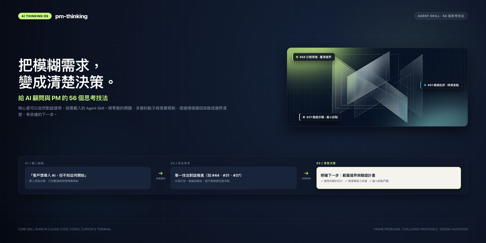
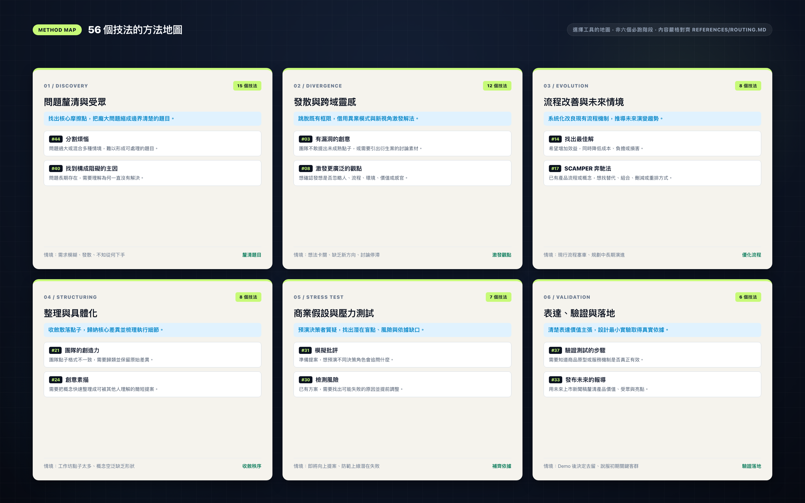
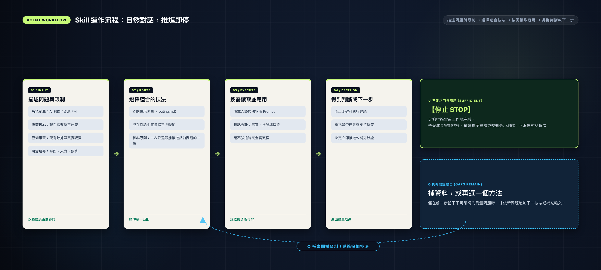

# AI Thinking OS

**56 thinking techniques for AI consultants and product managers who need to make a decision.**

Use an AI agent to frame a vague request, challenge a proposal, organize ideas, or design a validation experiment. The skill selects a relevant technique, separates assumptions from evidence, and stops when the requested work is done.

[繁體中文](README.md) · [Technique index](references/routing.md) · [Worked example](examples/ai-consulting.md)

The technique library and worked examples are currently in Traditional Chinese. This file is an English introduction.

## Start with one decision

Register the skill at the personal level once, then describe your problem naturally from any project. Codex or Claude Code uses the skill description to decide when to activate it; the skill then selects a suitable technique. The frontend and Jev are optional.

Keep the repository in a stable location. Run the relevant block from its root (the directory containing `SKILL.md`) on macOS or Linux:

```bash
# Codex
mkdir -p "$HOME/.agents/skills"
if [ ! -e "$HOME/.agents/skills/pm-thinking" ] && [ ! -L "$HOME/.agents/skills/pm-thinking" ]; then
  ln -s "$PWD" "$HOME/.agents/skills/pm-thinking"
fi

# Claude Code
mkdir -p "$HOME/.claude/skills"
if [ ! -e "$HOME/.claude/skills/pm-thinking" ] && [ ! -L "$HOME/.claude/skills/pm-thinking" ]; then
  ln -s "$PWD" "$HOME/.claude/skills/pm-thinking"
fi
```

These commands preserve existing entries; check any existing same-name skill before using it. Both links use the same source, so repository updates are shared. Moving or deleting the repository breaks the links. On Windows, copy the complete library into the corresponding personal skill directory and keep the copy updated.

Start a new agent session in any project and ask:

```text
Decision: Should we invest in a customer-support AI pilot?
Known: Agents frequently search product documentation. We have no timing baseline yet.
Constraints: Two weeks, two engineers, no production integration.

Choose one useful technique. Separate facts, inferences, and assumptions.
Give me a concrete next step. Respond in English.
```

Automatic invocation is an agent judgment, not a guarantee for every message. Ordinary debugging, refactoring, and text polishing should not trigger this skill. To check discovery, use `/skills` in Codex or find `pm-thinking` in Claude Code's `/` menu; restart the agent if it is missing. Explicit `$pm-thinking` (Codex) or `/pm-thinking` (Claude Code) is an optional override, not the normal entry point.

Without registration, ask a file-capable agent to read the actual path to `SKILL.md`. In a chat tool, paste the skill and the selected technique alongside your context.

Official discovery rules: [Codex](https://learn.chatgpt.com/docs/build-skills), [Claude Code](https://code.claude.com/docs/en/skills).

## Choose your entry point

| Situation | Technique | Useful output |
| --- | --- | --- |
| A client asks for “AI transformation” | [#44 Problem slicing](references/techniques/044-problem-slicing.md) | A bounded problem to investigate |
| A proposal needs scrutiny | [#31](references/techniques/031-executive-critique.md) Executive critique | Simulated objections and evidence gaps |
| An agent workflow may fail | [#30](references/techniques/030-risk-review.md) Risk review | Failure causes, mitigations, residual risks |
| A workshop produced too many ideas | [#21](references/techniques/021-idea-clustering.md) Idea clustering | Groups with traceable source IDs |
| A demo needs a business decision | [#37](references/techniques/037-validation-test.md) Validation test | Baseline, experiment, decision conditions |
| Product value is unclear | [#33](references/techniques/033-future-press-release.md) Future press release | A clearly labeled future scenario |

<br>



## How it works

The agent reads [SKILL.md](SKILL.md), selects a method through the [routing guide](references/routing.md) when needed, and loads only the selected technique. Additional methods are used when an unresolved question warrants them. All 56 techniques are optional tools, not a mandatory sequence.

Simulated stakeholder views are not interviews. A future press release is not demand validation. Market and competitor claims require actual sources; the library does not include a live search service.

<br>



## Contribute

Share a concrete decision, the technique you used, and what remained unclear. Remove confidential information before contributing. See [contribution guidance](CONTRIBUTING.md) and [content attribution and licensing status](ATTRIBUTION.md).
