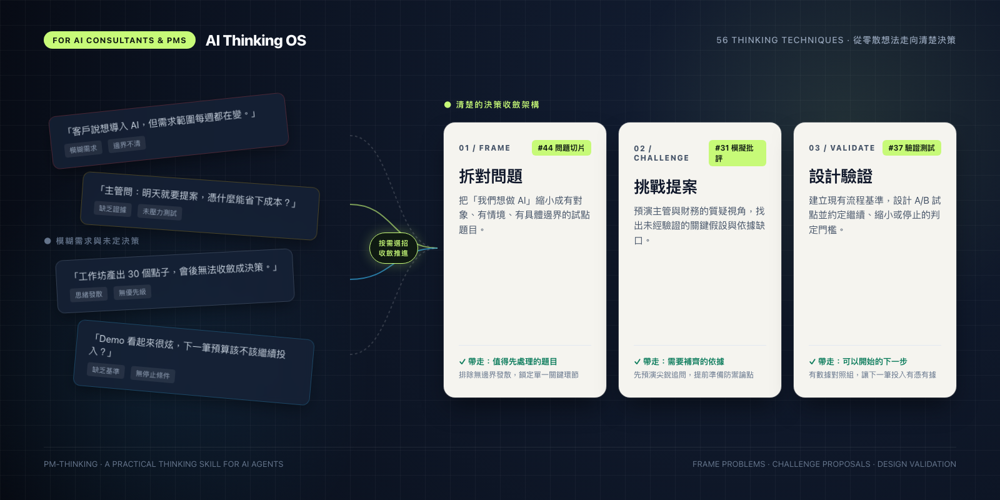
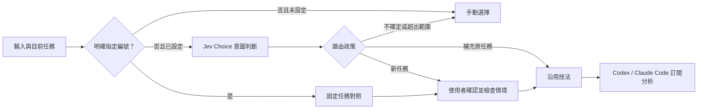
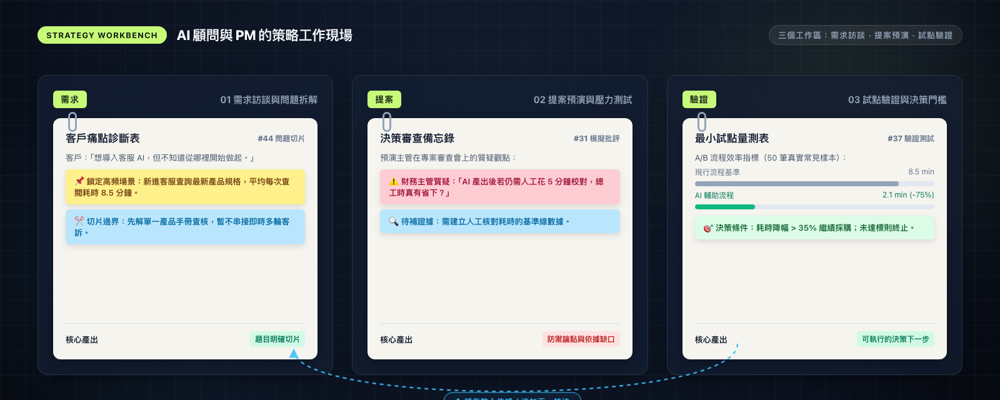
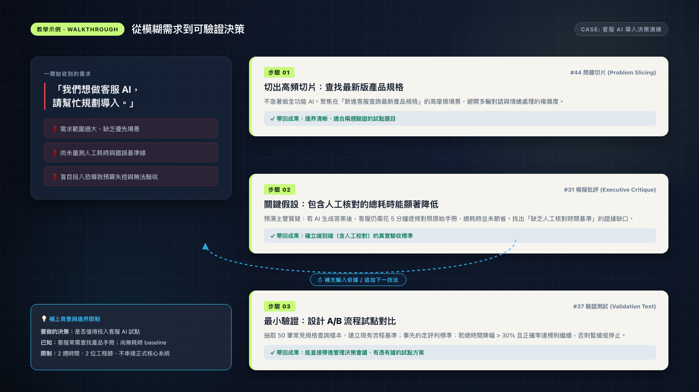
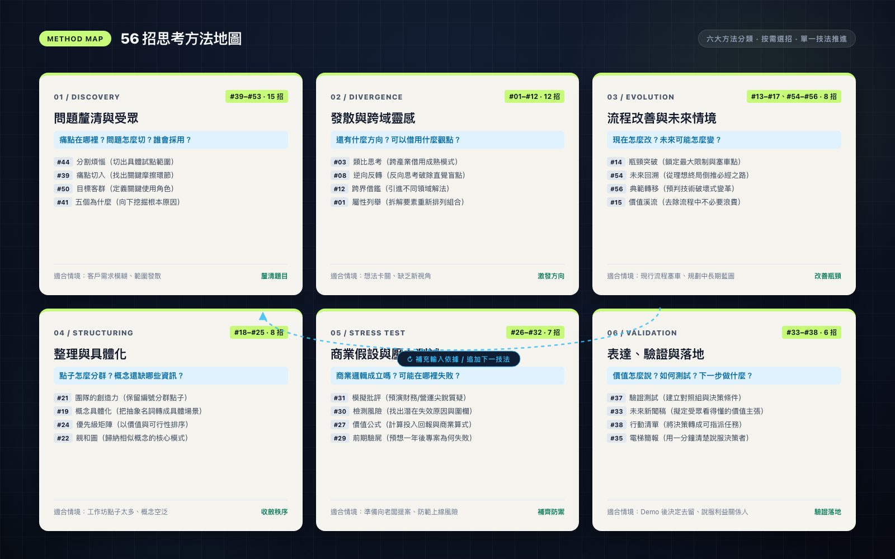
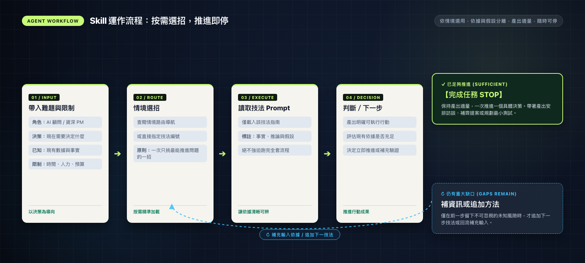

<div align="center">

<p><strong>THINK CLEARER. DECIDE BETTER.</strong></p>

<h1>AI Thinking OS</h1>

<h3>頭腦好的人都在使用的 AI 思考力</h3>

<p>給資深 AI 顧問與 PM 的思考工具箱。<br>拆對問題、挑戰提案、設計驗證，讓每一次 AI 協作更接近可執行的決策。</p>

<p><strong>56 個思考技法 &nbsp; / &nbsp; 6 大方法分類 &nbsp; / &nbsp; 按需載入的 Agent Skill</strong></p>

<p>
  <a href="#start">開始使用</a> &nbsp; · &nbsp;
  <a href="#demo">看一個案例</a> &nbsp; · &nbsp;
  <a href="references/routing.md">探索 56 招</a> &nbsp; · &nbsp;
  <a href="README.en.md">English</a>
</p>

<sub>品牌主張：把好問題、清楚的假設與可驗證的下一步，變成工作習慣。</sub>

</div>

<br>



<br>

## 先註冊為個人 skill：任何專案都能自然觸發

**安裝一次，之後直接描述問題。** 不必切到本 Repo，也不必每次輸入 skill 名稱或技法編號。Coding agent 依 `SKILL.md` 的 `description` 判斷何時啟用，啟用後再按情境選招；不需要前端或 Jev API key。

在本 Repo 根目錄（能看到 `SKILL.md` 的位置）執行下列指令。macOS／Linux 使用符號連結，兩個 agent 共用同一份方法庫，更新 Repo 後同步生效。

```bash
# Codex：個人層級，跨專案可用
mkdir -p "$HOME/.agents/skills"
if [ ! -e "$HOME/.agents/skills/pm-thinking" ] && [ ! -L "$HOME/.agents/skills/pm-thinking" ]; then
  ln -s "$PWD" "$HOME/.agents/skills/pm-thinking"
fi

# Claude Code：個人層級，跨專案可用
mkdir -p "$HOME/.claude/skills"
if [ ! -e "$HOME/.claude/skills/pm-thinking" ] && [ ! -L "$HOME/.claude/skills/pm-thinking" ]; then
  ln -s "$PWD" "$HOME/.claude/skills/pm-thinking"
fi
```

只使用其中一個 agent，就執行對應區塊。若目的地已有同名 skill，上述指令不會覆蓋；先檢查它是否指向這份 Repo。保留 Repo 的位置，搬動或刪除它會讓連結失效。Windows 可將完整方法庫複製到對應的個人 skills 目錄，更新時需同步副本。

開啟新的 Codex／Claude Code 對話，在任何專案直接說：

```text
客戶想導入客服 AI，但需求太散，不知道先做哪一塊。
客服每天查找規格文件，但還沒有耗時與錯誤率資料。
只有兩週、兩位工程師，不能串正式系統。
幫我釐清值得先解的問題。
```

預期 agent 自動啟用 `pm-thinking`，載入情境路由並選擇最少的適用技法。接著說「主管會怎麼質疑？」或「怎麼驗證真的有效？」，讓 agent 根據前文重新選招；一般 bug 修復、重構或純潤稿不應觸發。

自動選用由 agent 判斷，並非每句話都強制觸發。若沒有載入，可在 Codex 用 `/skills` 查看，或在 Claude Code 的 `/` 選單搜尋 `pm-thinking`；尚未顯示時重開 agent。`$pm-thinking`（Codex）、`/pm-thinking`（Claude Code）與技法編號保留作除錯或明確覆寫，並非日常必要步驟。

官方載入規則：[Codex skills](https://learn.chatgpt.com/docs/build-skills)、[Claude Code skills](https://code.claude.com/docs/en/skills)。

## 個人本機工作台（選用）

透過前端選擇「釐清需求／提案預演／設計驗證」，填寫決策、已知資訊與限制，再使用你本機已登入的 Codex 或 Claude Code 訂閱執行。

```bash
npm install
npm run build
npm start
```

開啟 http://127.0.0.1:4317 。需要 Node.js 22.12+ 與官方 CLI 訂閱登入；詳細設定、資料儲存及執行邊界請看 [工作台使用說明](app/README.md)。

## 怎麼觸發 skill？可直接貼上的 few-shot

完成上方個人註冊後，直接用自然語言。例如：

```text
客戶只說「想導入 AI」，需求一直變。
請先選一個技法拆出值得處理的問題；不要直接寫完整 PRD。
已知：客服每天查規格，還沒有耗時基準。
限制：兩週、兩位工程師、不得連正式資料。
```

尚未註冊時，可在本 Repo 對 agent 說「請讀取 ./SKILL.md」作為臨時入口。README 的例句本身不會註冊 skill；個人目錄中的 `SKILL.md` 才是 agent 發現技能的入口。

以下是**教學範例與預期路由，不是模型準確率測試結果**。背景、證據與限制請換成自己的資料。

| 輸入範例 | 建議技法／處理方式 | 預期產出 |
| :--- | :--- | :--- |
| 「客戶想做 AI，但問題太大，幫我拆小並選優先項。」 | #44 分割煩惱 | 問題切片、已知與假設、下一步 |
| 「明天要向財務與資訊主管提案，幫我預演追問。」 | #31 模擬批評 | 角色追問、證據缺口、會前行動 |
| 「摘要 Demo 做好了，如何驗證真的省下核對時間？」 | #37 驗證測試 | 比較基準、最小測試、停止條件 |
| 「使用 pm-thinking #21，把以下 30 個點子分群，保留原編號。」 | #21 團隊的創造力；完整 skill 可用，本機工作台尚未開放 | 可追溯的分群 |
| 已在釐清需求時：「補充：預算降為兩萬元，不能用正式資料。」 | 沿用原技法 | 更新限制，不因「預算」自動換招 |
| 「問題切好了，現在改用 #37 設計對照實驗。」 | 建議切到 #37 | 工作台先確認新任務與情境 |
| 「幫我處理一下。」／「預演提案和設計實驗都要，還沒決定先做哪個。」 | 先釐清 | 選一個這次要產出的成果 |
| 「幫我修 bug／部署上線。」 | 不觸發 PM 分析 | 交給適合的工程流程 |

知道編號時，可以直接指名：

```text
請讀取 ./SKILL.md，使用 pm-thinking #37。
決策：是否繼續投入 AI 訪談摘要試點？
已知：有十份經同意且去識別化的訪談，尚無時間與品質基準。
限制：一週、三位顧問；把人工核對時間算進去。
請設計最小驗證，分清假設與證據，完成即停。
```

### 在前端用 Jev 選招（選用）

工作台新增「先說你想解決什麼」。可輸入 `#44 問題…`、`#31 問題…` 或 `#37 問題…`，不需要 Jev；也可連接自己的 TypeSafe API key，用自然語言取得建議。



Jev 只提供判斷，後端負責白名單、技法載入與執行邊界。它不會自動安裝 skill、執行任意程式，或讓工作台從三個任務擴張到全部 56 招。詳見 [Jev 設定、資料流與驗證](app/README.md#jev-意圖選招選用)。

## AI 寫完了。接下來，輪到你做判斷。

客戶說想導入 AI。主管要你證明投資值得。團隊做出了 Demo，卻還說不清誰會用、為什麼用、什麼情況下應該停止。

**AI Thinking OS 幫你把這些難題，變成可以逐步處理的工作。**

你帶來決策、背景與限制；Agent 選擇合適的技法，協助拆解、追問、整理與驗證。一次先用一招，有需要才往下走。

| **拆對問題** | **挑戰提案** | **設計驗證** |
| :--- | :--- | :--- |
| 把「我們想做 AI」縮小成具體情境 | 預演決策者的質疑，找出證據缺口 | 把「應該有用」變成可檢驗的假設 |
| 帶走：**值得先處理的題目** | 帶走：**需要補齊的依據** | 帶走：**可以開始的下一步** |

<br>

## 為那些要對決策負責的人而做

**AI 顧問**需要把模糊需求轉成合理的專案範圍。**資深 PM**需要在資源有限、資訊不足時，說清楚為什麼先做這一件事。

從今天最卡的工作開始：

| 你現在卡在哪裡 | 先用這一招 | 你要拿到什麼 |
| :--- | :--- | :--- |
| 「客戶想導入 AI，但需求一直變。」 | [#44 分割煩惱](references/techniques/044-problem-slicing.md) | 有對象、有情境、有邊界的題目 |
| 「明天提案，最怕被問憑什麼。」 | [#31 模擬批評](references/techniques/031-executive-critique.md) | 尖銳追問、可用回答與證據缺口 |
| 「Demo 做完了，下一筆預算該不該花？」 | [#37 驗證測試](references/techniques/037-validation-test.md) | 比較基準、觀察指標與停止條件 |
| 「工作坊有 30 個點子，會後無法收斂。」 | [#21 團隊的創造力](references/techniques/021-idea-clustering.md) | 保留原始編號與差異的分群 |
| 「Agent 看起來什麼都能做，我擔心上線出事。」 | [#30 檢測風險](references/techniques/030-risk-review.md) | 失敗原因、緩解措施與剩餘風險 |
| 「大家都聽過這個概念，卻沒人說得清價值。」 | [#33 未來新聞稿](references/techniques/033-future-press-release.md) | 受眾、使用情境與價值主張草稿 |



<br>

<a id="demo"></a>

## 看一個案例：從「想做客服 AI」開始

> 以下為虛構情境與人工編寫的教學示例，並非客戶成果或模型測試紀錄。

### 一開始，你收到這個需求

```text
我們想做客服 AI，請幫忙規劃導入。
```

這句話還不足以決定要投入什麼。補上背景，才有辦法選擇下一步：

```text
要做的決策：是否值得投入客服 AI 試點。
已知：客服常需查找產品文件；尚未量測耗時與錯誤率。
限制：兩週、兩位工程師，先不串接正式系統。
```

### 用 #44，把需求拆成可研究的切片

| 候選切片 | 需要先問清楚的事 |
| :--- | :--- |
| 新進客服尋找最新版產品規格 | 文件有版本與生效日期嗎？ |
| 資深客服核對跨文件的產品資訊 | 查核時間主要花在哪一步？ |
| 非上班時間收到問題，隔天才能處理 | 延遲對客戶造成什麼影響？ |

如果能取得有版本資訊的文件，可以先探索第一個切片。這個方向符合初期限制；它是否足夠頻繁、是否值得解，仍需觀察實際流程。

### 當你需要決定是否投入，再用 #37 設計測試

將決策題目縮小為：

> **在限定的規格查詢情境中，AI 能否降低包含人工核對的總處理時間，並達到事先約定的答案品質門檻？**

取得經允許的樣本，建立現有流程的基準，再比較 AI 輔助流程。事先約定繼續、縮小與停止的條件，讓測試結果能影響決策。

**你帶回會議的成果：一個範圍清楚、知道如何驗證的試點題目。**



→ [閱讀完整案例：需求診斷、提案預演、試點驗證](examples/ai-consulting.md)

<br>

<a id="start"></a>

## 把你現在的難題帶進來

### 01　準備方法庫

下載本 Repo，保留 `SKILL.md` 與完整 `references/` 目錄，依上方說明註冊到個人 skills 目錄。

### 02　貼上你的決策與限制

註冊後可在任何專案直接描述需求：

```text
我的角色：［AI 顧問／PM／其他］
要做的決策：［現在需要決定什麼］
已知情況：［已有資料與觀察］
限制：［時間、人力、預算、資料或權限］

先選最能推進問題的一個技法，簡短說明選用理由。
分清已知、推論與待驗證假設。
給我一個可以開始的下一步，完成後就停止。
```

### 03　帶著結果推進工作

拿產出去安排訪談、補提案證據或規劃測試。前一步留下重要問題時，再追加方法。

<details>
<summary><strong>我已經知道要用哪一招</strong></summary>

直接指定編號，Agent 可跳過選招：

```text
請讀取 ./SKILL.md，使用 pm-thinking 的 #31。

預演這份提案會遇到的質疑，分別模擬財務、資訊與營運主管的視角。
每個問題標示：已有證據、回答缺口、需要補的資料。
角色觀點是模擬；缺資料就直接說缺資料。

提案內容：［貼上你的提案］
```

</details>

<details>
<summary><strong>我想在一般 AI 對話裡使用</strong></summary>

開啟 [情境索引](references/routing.md)，挑一個方法。把 [SKILL.md](SKILL.md) 的執行原則與該方法全文一起貼入對話，再補上題目與限制。

若使用檔案上傳，先確認對話工具能讀取所提供的檔案。上述用法不需要全域安裝；本 Repo 未宣稱已驗證各平台的原生 Plugin 相容性。

</details>

→ [直接複製六個顧問與 PM 工作指令](docs/playbook.md)

<br>

## 56 招，從你需要的產出開始選

| 方法分類 | 適合處理的問題 | 技法編號 |
| :--- | :--- | :--- |
| **問題釐清與受眾** | 痛點在哪裡？問題怎麼切？誰會採用？ | #39–#53 |
| **發散與跨域靈感** | 還有什麼方向？可以借用什麼觀點？ | #01–#12 |
| **流程改善與未來情境** | 現在怎麼改？未來可能怎麼變？ | #13–#17、#54–#56 |
| **整理與具體化** | 點子怎麼分群？概念還缺哪些資訊？ | #18–#25 |
| **商業假設與壓力測試** | 商業邏輯成立嗎？可能在哪裡失敗？ | #26–#32 |
| **表達、驗證與落地** | 價值怎麼說？如何測試？下一步做什麼？ | #33–#38 |



→ [開啟完整方法索引與選用邊界](references/routing.md)

<br>

## 用一招推進，足夠了就停止

**先讀入口，按需選招，再讀取對應方法。** 已指定編號時直接載入該技法；需要選擇時才讀情境路由。

| 執行原則 | 在工作中代表什麼 |
| :--- | :--- |
| **依情境選用** | 56 招都是工具，不需要每次跑完整套流程。 |
| **讓依據可辨認** | 觀察、推論、假設與角色模擬分開表達。 |
| **保持產出適量** | 只要歸類，就完成歸類；需要計畫，才展開計畫。 |
| **保留停止選項** | 縮小、暫緩或停止，都可以是有價值的判斷。 |



<br>

## 使用前，知道它的邊界

<details>
<summary><strong>方法、證據與實際決策的關係</strong></summary>

角色模擬幫你預演問題，不能當成訪談紀錄。未來新聞稿幫你釐清價值，不能當成需求驗證。功能可運作，也不代表有人願意付費。

需要市場、競品或最新趨勢時，仍須取得實際來源；這份方法庫本身不提供即時搜尋服務。README 的品牌標語不代表已驗證的使用者採用情況。

</details>

<details>
<summary><strong>專案結構與技術入口</strong></summary>

對外品牌是 **AI Thinking OS**，Agent 使用的 skill 名稱仍為 `pm-thinking`。

```text
SKILL.md                 Agent 執行入口
references/
├── routing.md           情境路由與完整索引
└── techniques/          56 個技法的指南與原始 Prompt
examples/                顧問與 PM 教學示例
docs/playbook.md         六個可複製的工作入口
docs/launch-kit.md       Repo 簡介與宣傳文案
assets/img/              首頁主視覺與方法流程圖解 PNG
ATTRIBUTION.md           內容來源與授權狀態
CONTRIBUTING.md          貢獻指南
```

</details>

<details>
<summary><strong>內容來源與授權狀態</strong></summary>

技法檔案保留使用者提供的《使用 AI 思考的 56 種技法》原始 Prompt，並將使用指南與原文分開。目前未指定整份 Repo 的開源授權；原始 Prompt 的公開散布授權仍待確認。

詳見 [內容來源與授權說明](ATTRIBUTION.md)。

</details>

<br>

---

<div align="center">

<h2>從一個值得想清楚的問題開始。</h2>

<p>帶著你現在的決策，選一招，試一次。<br>看看它能否幫你找出原本忽略的問題，或更有依據的下一步。</p>

<p><a href="#start"><strong>開始使用 →</strong></a> &nbsp; · &nbsp; <a href="docs/playbook.md">取得工作指令</a> &nbsp; · &nbsp; <a href="CONTRIBUTING.md">分享使用案例</a></p>

<p>如果它幫你釐清了一個難題，歡迎 Star 收藏，<br>也分享給下一位正在為決策傷腦筋的同事。</p>

<sub>AI Thinking OS · 把 AI 產出，推進到產品決策。</sub>

</div>
